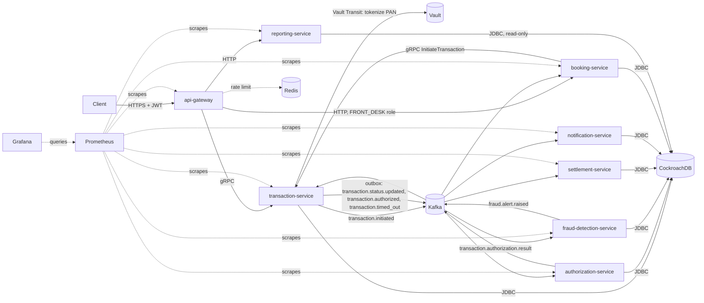

# Credit Card Payment Gateway

A payment processing system — authorization, fraud detection, settlement,
notifications, and reporting, fronted by an API gateway and driven
end-to-end by Kafka — built to rehearse the full lifecycle of a real
microservices stack: local development, CI with 100% test coverage, a
Kubernetes dry run on `kind`, and a path to a real GKE deployment. Every
piece (tokenization, rate limiting, circuit breaking, settlement
batching) is wired for real, not stubbed, and verified by a 14-step
end-to-end test against a live card submission.

**Layered on top of that payment core** is a hotel booking system,
added one layer at a time (see `CLAUDE.md`'s Roadmap): `booking-service`
(layers 2a + 2b) is rooms, availability search, the front-desk-staff
booking saga, room status (check-in/check-out/housekeeping), and the
room board; layer 2c adds per-stay charges and balance-due checkout.
Hotel layers never touch card data themselves; they only ask the
payment core to charge and react to the result over the same gRPC/Kafka
contracts the original 7 services already use. Layer 2d (`frontend/`,
**Hotel Payment App**) connects a real staff UI to all of it — see
[Running locally](#running-locally)'s "Frontend" section.

## Services

| Service | Role |
|---|---|
| `api-gateway` | External REST entry point — JWT auth, per-route RBAC, rate limiting, circuit breaking, bridges REST→gRPC for `transaction-service` |
| `transaction-service` | Tokenizes cards via Vault, persists transactions, publishes `transaction.initiated` |
| `authorization-service` | Consumes `transaction.initiated`, authorizes/declines against a card account's credit, publishes `transaction.status.updated` |
| `fraud-detection-service` | Consumes `transaction.initiated` in parallel, evaluates and records a fraud decision |
| `notification-service` | Consumes `transaction.status.updated`, sends email/SMS notifications |
| `settlement-service` | Batches authorized transactions into settlement runs (Spring Batch) |
| `reporting-service` | Read-only queries across the other services' data for dashboards/support |
| `booking-service` | **Layers 2a + 2b.** Room inventory, availability search, and the staff booking saga (HELD → charge via `transaction-service` → CONFIRMED/CANCELLED); room status, check-in/check-out, and the room board, consuming the same `transaction.status.updated` event |

## Architecture



Each service owns its own schema in a shared CockroachDB cluster (no
cross-service table access except `reporting-service`'s intentionally
read-only queries) and talks to its neighbors only through Kafka events
or, for the gateway's hot path to `transaction-service` (and
`booking-service`'s own call to it), gRPC. Card numbers are tokenized
via Vault's Transit engine before anything ever touches a database or
log line — Step 6 of the e2e test (below) scans every service's logs
for the raw PAN on every run to prove that. `booking-service` never
receives a tokenized or raw card number back from this path — it only
forwards what the caller submitted to `transaction-service` and reacts
to the resulting `transaction.status.updated` event, the same contract
`notification-service` and `settlement-service` already consume.

`transaction-service` is the only publisher of transaction outcomes. Authorization
and the PENDING timeout sweep report to it, and it records each final state with a
conditional `PENDING -> final` update. Events for that state are written to a
transactional outbox in the same database transaction and published right after
commit; a polling relay (every 500 ms) sends any row that was not sent. Consumers
therefore see one final outcome per transaction, in the order its events were written
(events for different transactions are not ordered against each other).

A PENDING transaction older than 300 s is failed with reason `TIMEOUT`, and
`transaction.timed_out` is published. Authorization releases any credit it held for
that transaction, and skips a late `transaction.initiated` for it. Settlement only
receives `transaction.authorized` for transactions that were actually authorized, so a
timed-out transaction is never settled. Timer values and their rules are in
`specs/013-transaction-pending-timeout/design.md`.

## Tech stack

- **Services**: Java 17, Spring Boot 3.2, Spring Data JPA, Spring Kafka, Spring Cloud Gateway (WebFlux)
- **Resilience**: Resilience4j (circuit breakers on the gateway's calls to `transaction-service`, `reporting-service`, and `booking-service` — the booking-submission route carries its own longer timeout, see Engineering challenges below), Redis-backed rate limiting
- **Transport**: gRPC (gateway → transaction-service), Kafka (everything else), REST
- **Data**: CockroachDB (Postgres wire protocol), Flyway migrations per service
- **Secrets**: HashiCorp Vault (Transit engine for PAN tokenization)
- **Observability**: Micrometer → Prometheus → Grafana (request rate/error rate/latency/Kafka lag/circuit breaker state, one dashboard, see `k8s/infra/grafana-dashboard.yaml`)
- **Testing**: JUnit 5, Testcontainers 2.0.5 (CockroachDB), Spring's `@EmbeddedKafka`, JaCoCo (100% instruction+branch coverage gate in CI)
- **Infra**: Docker Compose (local dev), `kind` (local Kubernetes rehearsal), GKE (real deployment — see [docs/GKE.md](docs/GKE.md)), Kustomize overlays for per-environment replica counts and image sources

## Running locally

### Docker Compose (fastest)

```bash
cp .env.example .env   # dev-only defaults, see SECURITY.md
docker compose up -d --build
./scripts/e2e-test.sh
```

### kind (Kubernetes rehearsal)

Brings up the same 7 services plus Prometheus/Grafana on a local
single-node Kubernetes cluster — a dry run for GKE, at 1 replica per
service to keep memory pressure low during rollouts (`k8s/overlays/kind`;
GKE's overlay keeps the real default of 2).

```bash
./scripts/k8s-up.sh
./scripts/e2e-test.sh --target kind
```

Open Grafana (anonymous viewer access, no login needed):

```bash
kubectl port-forward -n credit-card svc/grafana 3000:3000
open http://localhost:3000
```

Tear down with `./scripts/k8s-down.sh`.

### GKE

A minimal, cost-conscious path (zonal cluster, spot node pool, $5 budget
alert) is documented in [docs/GKE.md](docs/GKE.md), with
`scripts/gke-deploy.sh` and `scripts/demo-up.sh` / `demo-down.sh` to
scale the node pool between demos without tearing anything else down.

### Frontend

**Hotel Payment App** (`frontend/`) is the staff room board (layer 2d) —
talking to the real backend, not mock data, behind a dev-only role-picker
login. `/staff` is the only app; every other path redirects there. Needs
the Docker Compose stack from above (which now also brings up a standing,
**dev-only** `auth-mock` service for that login — see SECURITY.md; it
exists only in `docker-compose.yml`/CI, never in `k8s/` or any deployed
environment):

```bash
docker compose up -d --build   # brings up auth-mock too
cd frontend
npm install
npm run dev
```

Open `http://localhost:5173` (redirects to `/staff`), pick a role (Front
Desk or Housekeeping), and sign in — talking to the real
`booking-service`/`api-gateway` through `/api/v1/rooms/board` and the
booking/check-in/check-out/charges endpoints layers 2a-2c already built.

Tests:

```bash
npm test               # Vitest + React Testing Library + MSW
npm run test:coverage  # same, with the 100% coverage gate
npx playwright install --with-deps chromium   # once, before the next line
npm run e2e             # Playwright smoke test — needs the stack + `npm run dev` already up
```

## How the e2e test works

`scripts/e2e-test.sh` drives one real card transaction through every
service and asserts on each hop:

1. **Start/connect** — brings up Compose, or port-forwards into kind
2. **Health checks** — every service's `/actuator/health`
3. **JWT** — issued by a throwaway mock auth server (RSA keypair generated fresh each run)
4. **Submit payment** — `POST /api/v1/transactions` through the gateway
5. **Poll status** — until `AUTHORIZED`
6. **PAN scan** — greps every service's logs for the raw card number (must find none)
7. **Rate limit** — 100 concurrent requests against a 20-request burst capacity, expects `429`s
8. **Circuit breaker** — stops `transaction-service`, expects a `503` fallback, then confirms the breaker actually returns to `CLOSED` once the service is back (not just that the service is healthy — those are different things, see the fix below)
9. **Reporting query** — confirms `reporting-service` returns the transaction with a masked card number
10. **Settlement** — triggers a settlement batch, polls until `SETTLED`
11. **Fraud + notification records** — confirms both side-effects landed in their own services' tables
12. **Booking confirmed** — a `FRONT_DESK`-role staff JWT books a room through `booking-service` with a card the payment core authorizes; polls until the booking reaches `CONFIRMED` (compose only — `booking-service` has no `kind`/GKE manifests yet)
13. **Booking declined** — books a different room with a card that has no seeded account (an automatic decline, no extra seeding needed); confirms the booking reaches `CANCELLED` with reason `PAYMENT_DECLINED` and the room reappears in availability search (compose only)
14. **Room board lifecycle** — book → confirm → check-in (`FRONT_DESK`) → board shows that room `OCCUPIED` with the guest's name → check-out → board shows `DIRTY` → housekeeping marks it `VACANT_CLEAN` → board shows `VACANT_CLEAN` again (compose only)

A separate Playwright smoke test (`frontend/e2e/`) covers the same lifecycle
through the actual staff UI rather than the raw API — see "Frontend" below.

## Engineering challenges

A few problems along the way were non-obvious enough to be worth
recording here, in brief — fuller detail lives in the corresponding
commit messages.

**The async pipeline silently diverged on event shape.** Each service
evolved its Kafka event contracts independently, and `authorization-service`
ended up consuming a slightly different envelope shape than
`transaction-service` actually published — the kind of mismatch that
doesn't fail loudly, it just quietly drops or misreads fields. Fixed by
standardizing envelope conformance across the pipeline, making
tokenization deterministic (so the same PAN always maps to the same
token — `settlement-service` and `reporting-service` both need to
recognize the same card across independent transactions), and adding
`reporting-service`'s single-transaction lookup endpoint that the e2e
test's Step 9 actually needed and didn't have. All steps pass
end-to-end as a result.

**A circuit-breaker timeout shorter than the backend's own deadline.**
`booking-service`'s booking-submission saga calls `transaction-service`
over gRPC with its own 5s deadline — correct in isolation, but the
gateway's default circuit-breaker/time-limiter timeout was *also* 5s, on
the same route. Under any real latency the gateway gave up and served a
503 fallback before `booking-service`'s own deadline logic ever got a
chance to run — observed live on docker-compose, not just in a test.
Fixed by giving that one route its own breaker id with a 10s timeout
(every other route, including the booking service's other two routes,
is unaffected), and added an integration test that asserts a 7s backend
delay now succeeds on booking-submission but still falls back on
room-search — proving the fix is scoped to the one route that needed
it, not a blanket loosening.

**Testcontainers stopped finding Docker — on a CI image we didn't change.**
CI started failing with every Testcontainers-backed test throwing
`DockerClientProviderStrategy` errors before any test code ran, on a
branch that touched zero test infrastructure. Root cause, confirmed by
bisecting across unrelated PRs: GitHub's `ubuntu-latest` runner image
quietly migrated from `ubuntu-24.04` to `ubuntu-26.04`, which ships a
newer Docker Engine whose minimum supported API version Testcontainers
1.19.7's old default no longer satisfied. Pinned to `ubuntu-24.04` as an
immediate fix, then upgraded to Testcontainers 2.0.5 (which raised that
default) and reverted the pin — fixing the actual incompatibility
instead of permanently dodging a newer image.

**Kafka wouldn't come back after a Docker Desktop restart.** Restarting
Docker Desktop with the local kind cluster up recreates the node
container, and every pod's sandbox along with it. Kafka's broker data
persists on its own PVC — including the cluster ID Zookeeper originally
assigned it — but Zookeeper's own state didn't reliably survive the
same restart, so it came back with a *new* cluster ID. Kafka then
refused to start, forever:
`InconsistentClusterIdException: The broker is trying to join the wrong
cluster`. Every one of the 7 services has a `wait-for-kafka`
initContainer, so this one mismatch stalled the entire stack. Fixed by
having Kafka's own startup command compare its stored cluster ID against
Zookeeper's current one on *every* restart attempt (not a separate
initContainer — those run once per pod, not per container restart, and
raced Zookeeper's own concurrent recovery) and clear only its own stale
metadata on a mismatch. Validated by actually restarting Docker Desktop
with the cluster up, repeatedly, until it recovered on its own.

## Known limitations

- No refunds, voids or reversals. A transaction that was already settled stays settled.
- The booking-service startup check for the timeout timer rules is not wired yet
  (see `docs/BACKLOG.md`).
- Booking's room search does not look at housekeeping status, so check-in can still
  reject a room that the search returned. The e2e test works around this by reading
  the board.
- Local e2e runs reuse the same Docker volumes, so room and booking state carries over
  between runs.

## Project layout

```
services/<name>/       8 independent Spring Boot services (7-service payment core
                        + booking-service, the first hotel layer on top of it)
frontend/               React + TypeScript SPA: the existing owner-dashboard/
                        payment-submission prototype (mock data, PIN login) plus
                        /staff (layer 2d) — a real staff room board against the
                        live backend, dev-only role-picker login
k8s/base/               Kubernetes manifests, replicas: 2 (the GKE default) —
                        the 7 payment-core services; booking-service's k8s/GKE
                        wiring is deferred to the backlog (see CLAUDE.md)
k8s/overlays/kind       1 replica per service, local-only images
k8s/overlays/gke        images rewritten to Artifact Registry
k8s/infra/              CockroachDB, Kafka, Zookeeper, Vault, Redis, Prometheus, Grafana
scripts/                k8s-up/down, gke-deploy, demo-up/down, e2e-test
docs/GKE.md             exact gcloud commands for a real deployment
docs/BACKLOG.md         scope deliberately deferred to a later layer or pass
SECURITY.md             what's dev-only and must not ship as-is
```
