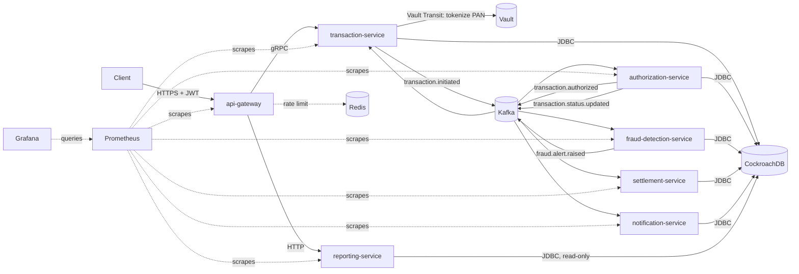

# Credit Card Payment Gateway

A 7-service payment processing system — authorization, fraud detection,
settlement, notifications, and reporting, fronted by an API gateway and
driven end-to-end by Kafka — built to rehearse the full lifecycle of a
real microservices stack: local development, CI with 100% test coverage,
a Kubernetes dry run on `kind`, and a path to a real GKE deployment.
Every piece (tokenization, rate limiting, circuit breaking, settlement
batching) is wired for real, not stubbed, and verified by an 11-step
end-to-end test against a live card submission.

## Architecture



Each service owns its own schema in a shared CockroachDB cluster (no
cross-service table access except `reporting-service`'s intentionally
read-only queries) and talks to its neighbors only through Kafka events
or, for the gateway's hot path to `transaction-service`, gRPC. Card
numbers are tokenized via Vault's Transit engine before anything ever
touches a database or log line — Step 6 of the e2e test (below) scans
every service's logs for the raw PAN on every run to prove that.

## Tech stack

- **Services**: Java 17, Spring Boot 3.2, Spring Data JPA, Spring Kafka, Spring Cloud Gateway (WebFlux)
- **Resilience**: Resilience4j (circuit breakers on the gateway's calls to `transaction-service` and `reporting-service`), Redis-backed rate limiting
- **Transport**: gRPC (gateway → transaction-service), Kafka (everything else), REST
- **Data**: CockroachDB (Postgres wire protocol), Flyway migrations per service
- **Secrets**: HashiCorp Vault (Transit engine for PAN tokenization)
- **Observability**: Micrometer → Prometheus → Grafana (request rate/error rate/latency/Kafka lag/circuit breaker state, one dashboard, see `k8s/infra/grafana-dashboard.yaml`)
- **Testing**: JUnit 5, Testcontainers 2.0.5 (CockroachDB), Spring's `@EmbeddedKafka`, JaCoCo (100% instruction+branch coverage gate in CI)
- **Infra**: Docker Compose (local dev), `kind` (local Kubernetes rehearsal), GKE (real deployment — see [docs/GKE.md](docs/GKE.md)), Kustomize overlays for per-environment replica counts and image sources

## Running locally

### Docker Compose (fastest)

```bash
cp .env.example .env   # dev-only defaults, see SECURITY.md
docker compose up -d --build
./scripts/e2e-test.sh
```

### kind (Kubernetes rehearsal)

Brings up the same 7 services plus Prometheus/Grafana on a local
single-node Kubernetes cluster — a dry run for GKE, at 1 replica per
service to keep memory pressure low during rollouts (`k8s/overlays/kind`;
GKE's overlay keeps the real default of 2).

```bash
./scripts/k8s-up.sh
./scripts/e2e-test.sh --target kind
```

Open Grafana (anonymous viewer access, no login needed):

```bash
kubectl port-forward -n credit-card svc/grafana 3000:3000
open http://localhost:3000
```

Tear down with `./scripts/k8s-down.sh`.

### GKE

A minimal, cost-conscious path (zonal cluster, spot node pool, $5 budget
alert) is documented in [docs/GKE.md](docs/GKE.md), with
`scripts/gke-deploy.sh` and `scripts/demo-up.sh` / `demo-down.sh` to
scale the node pool between demos without tearing anything else down.

## How the e2e test works

`scripts/e2e-test.sh` drives one real card transaction through every
service and asserts on each hop:

1. **Start/connect** — brings up Compose, or port-forwards into kind
2. **Health checks** — every service's `/actuator/health`
3. **JWT** — issued by a throwaway mock auth server (RSA keypair generated fresh each run)
4. **Submit payment** — `POST /api/v1/transactions` through the gateway
5. **Poll status** — until `AUTHORIZED`
6. **PAN scan** — greps every service's logs for the raw card number (must find none)
7. **Rate limit** — 100 concurrent requests against a 20-request burst capacity, expects `429`s
8. **Circuit breaker** — stops `transaction-service`, expects a `503` fallback, then confirms the breaker actually returns to `CLOSED` once the service is back (not just that the service is healthy — those are different things, see the fix below)
9. **Reporting query** — confirms `reporting-service` returns the transaction with a masked card number
10. **Settlement** — triggers a settlement batch, polls until `SETTLED`
11. **Fraud + notification records** — confirms both side-effects landed in their own services' tables

## Engineering challenges

A few problems along the way were non-obvious enough to be worth
recording here, in brief — fuller detail lives in the corresponding
commit messages.

**The async pipeline silently diverged on event shape.** Each service
evolved its Kafka event contracts independently, and `authorization-service`
ended up consuming a slightly different envelope shape than
`transaction-service` actually published — the kind of mismatch that
doesn't fail loudly, it just quietly drops or misreads fields. Fixed by
standardizing envelope conformance across the pipeline, making
tokenization deterministic (so the same PAN always maps to the same
token — `settlement-service` and `reporting-service` both need to
recognize the same card across independent transactions), and adding
`reporting-service`'s single-transaction lookup endpoint that the e2e
test's Step 9 actually needed and didn't have. All 11 steps pass
end-to-end as a result.

**Testcontainers stopped finding Docker — on a CI image we didn't change.**
CI started failing with every Testcontainers-backed test throwing
`DockerClientProviderStrategy` errors before any test code ran, on a
branch that touched zero test infrastructure. Root cause, confirmed by
bisecting across unrelated PRs: GitHub's `ubuntu-latest` runner image
quietly migrated from `ubuntu-24.04` to `ubuntu-26.04`, which ships a
newer Docker Engine whose minimum supported API version Testcontainers
1.19.7's old default no longer satisfied. Pinned to `ubuntu-24.04` as an
immediate fix, then upgraded to Testcontainers 2.0.5 (which raised that
default) and reverted the pin — fixing the actual incompatibility
instead of permanently dodging a newer image.

**Kafka wouldn't come back after a Docker Desktop restart.** Restarting
Docker Desktop with the local kind cluster up recreates the node
container, and every pod's sandbox along with it. Kafka's broker data
persists on its own PVC — including the cluster ID Zookeeper originally
assigned it — but Zookeeper's own state didn't reliably survive the
same restart, so it came back with a *new* cluster ID. Kafka then
refused to start, forever:
`InconsistentClusterIdException: The broker is trying to join the wrong
cluster`. Every one of the 7 services has a `wait-for-kafka`
initContainer, so this one mismatch stalled the entire stack. Fixed by
having Kafka's own startup command compare its stored cluster ID against
Zookeeper's current one on *every* restart attempt (not a separate
initContainer — those run once per pod, not per container restart, and
raced Zookeeper's own concurrent recovery) and clear only its own stale
metadata on a mismatch. Validated by actually restarting Docker Desktop
with the cluster up, repeatedly, until it recovered on its own.

## Project layout

```
services/<name>/       7 independent Spring Boot services
k8s/base/               Kubernetes manifests, replicas: 2 (the GKE default)
k8s/overlays/kind       1 replica per service, local-only images
k8s/overlays/gke        images rewritten to Artifact Registry
k8s/infra/              CockroachDB, Kafka, Zookeeper, Vault, Redis, Prometheus, Grafana
scripts/                k8s-up/down, gke-deploy, demo-up/down, e2e-test
docs/GKE.md             exact gcloud commands for a real deployment
SECURITY.md             what's dev-only and must not ship as-is
```
