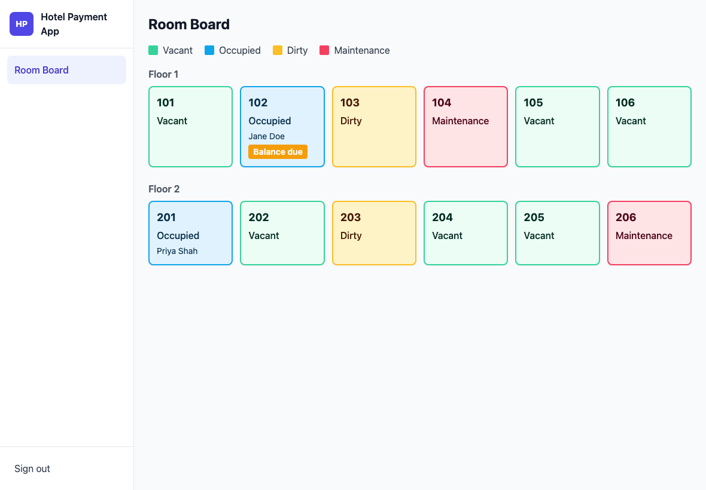
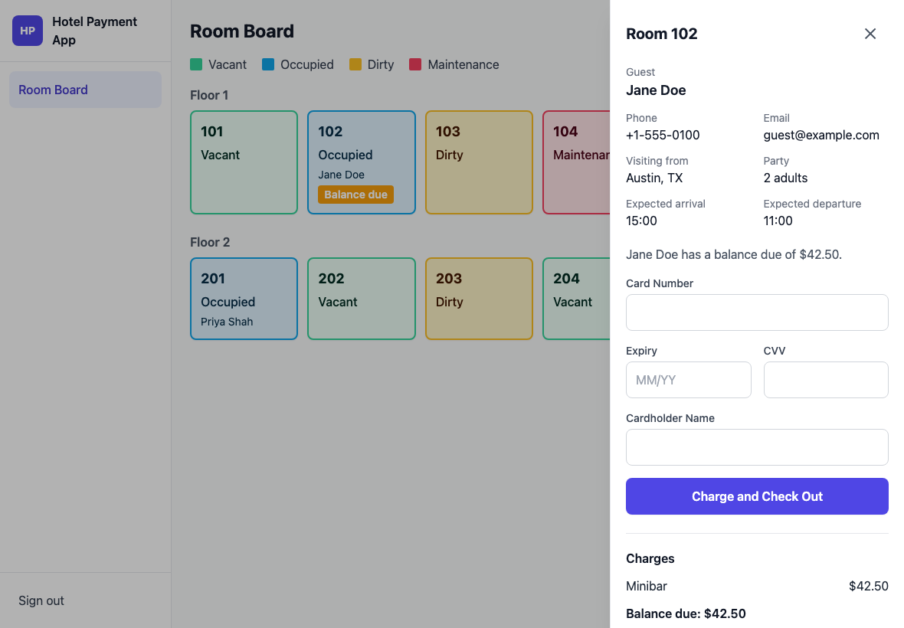
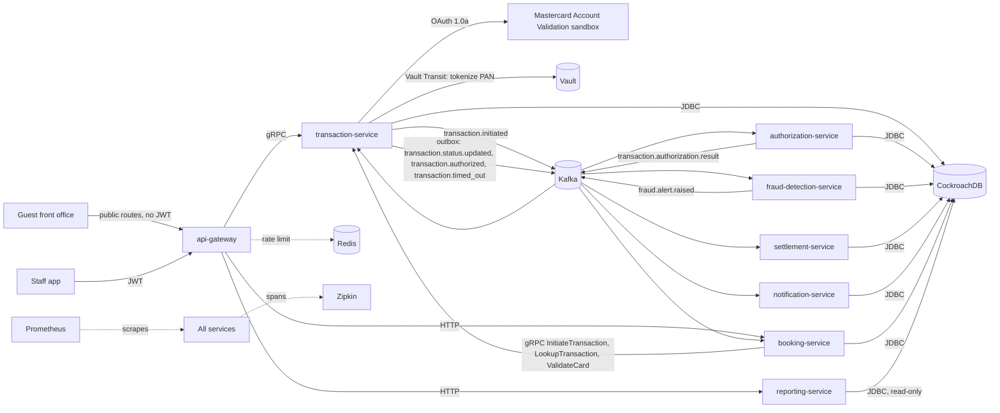

# Credit Card Payment Gateway

A hotel payments system: a **card-payment core** (authorization, fraud checks, settlement,
notifications, reporting, behind an API gateway and driven by Kafka) with a **hotel booking
system** on top. Guests book and are checked against Mastercard without being charged; staff run
the room board, check guests in, add charges, and take payment at checkout. It is built to rehearse
the full lifecycle of a real microservices stack: CI with an enforced 90% coverage gate, a live
end-to-end test, and Docker Compose, `kind` and GKE deployments. **The current version runs
locally with Docker Compose; see [Running locally](#running-locally) and [docs/DEMO.md](docs/DEMO.md).**

## What it does

**Guest front office** (`/`, no sign-in). A guest picks dates, sees the free rooms with a price for
the stay and what is included, and books. They enter a card, but **nothing is charged**: the card is
only checked with Mastercard Account Validation to guarantee a pay-later booking. The system keeps
the verdict, Mastercard's reference and the last 4 digits, never the card number or CVC.

**Staff app** (`/staff`, role-picker dev login). Front desk see a room board coloured by status,
check guests in, add charges (minibar, room service), and check out; checkout charges the balance
through the payment core. Housekeeping mark dirty rooms clean. Bookings made online carry an
**ONLINE** badge.

| Room board | Checkout with a balance |
|---|---|
|  |  |

*These screenshots are of the staff app only. They were taken before the guest front office was added,
so there is no screenshot of it yet.*

## Services

| Service | Role |
|---|---|
| `api-gateway` | The only external entry point: JWT auth, per-route roles, rate limiting, circuit breaking, REST to gRPC for `transaction-service`. Exactly two guest routes are open without a token, and rate-limited by IP |
| `transaction-service` | Tokenizes cards via Vault, records transactions, publishes outcomes through an outbox, and answers `ValidateCard` (Mastercard Account Validation) |
| `authorization-service` | Authorizes or declines a transaction through a payment processor (the built-in simulator by default) and reports the result |
| `fraud-detection-service` | Evaluates each transaction in parallel and records a fraud decision |
| `notification-service` | Sends payment emails (Mailpit locally) to a registered cardholder contact |
| `settlement-service` | Batches authorized transactions into settlement runs (Spring Batch), with a configurable acquirer label |
| `reporting-service` | Read-only queries across the other services' data |
| `booking-service` | Rooms, availability, bookings, room status and the board, per-stay charges, the checkout payment saga, and the guest card check |
| `frontend/` | React app: the guest front office and the staff app |
| `libs/mastercard-gateway`, `libs/mastercard-developers` | Mastercard clients: Gateway (payments) and Developers (OAuth 1.0a signed Account Validation) |

Hotel code never touches card data on its own: it hands the card to the payment core for one charge or
one check, and reacts to the result.

## Architecture



Each service owns its own schema in a shared CockroachDB cluster (only `reporting-service` reads
across them, read-only) and talks to its neighbours through Kafka events or gRPC. Card numbers are
tokenized via Vault's Transit engine before anything reaches a database or log line; step 6 of the
e2e test scans every service's logs for the raw card number on every run.

## How a payment flows

1. At checkout, `booking-service` records a PENDING checkout attempt, then calls `transaction-service`
   over gRPC with the card.
2. `transaction-service` tokenizes the card, saves the transaction as PENDING and publishes
   `transaction.initiated`.
3. `authorization-service` and `fraud-detection-service` each consume it. Authorization decides and
   reports back; `transaction-service` records the final state and publishes it through its outbox.
4. `booking-service` completes the checkout (`CHECKED_OUT`, room becomes Dirty), `notification-service`
   sends the email, and `settlement-service` queues the transaction for the next batch.
5. A settlement run (nightly at 23:59, or `POST /internal/settlement/trigger`) settles it. Reporting
   then shows the batch, including the acquirer name.

## Mastercard

- **Account Validation: working, against Mastercard's sandbox.** Guest bookings are guaranteed by a
  no-charge check (`libs/mastercard-developers`, signed with Mastercard's `oauth1-signer`). Not
  matched is a `422` with a message for the guest; Mastercard unreachable is a `503` and the booking is
  not confirmed (fail closed). The switch `card-validation.enabled` is **off by default**, so CI and
  the e2e need no credentials, and on in the `dev` profile. Details and the sandbox test card:
  [docs/CARD_VALIDATION.md](docs/CARD_VALIDATION.md). The sandbox returns mock answers; real use needs
  Mastercard's test and production environments.
- **Mastercard Gateway: built, switched off.** `authorization-service` can approve, decline, capture and
  void through Mastercard Gateway (`libs/mastercard-gateway`, `specs/014-mastercard-mtf-processor`), but
  `PAYMENT_PROCESSOR` defaults to `simulated` and stays there until a Mastercard test merchant account
  is available. Payments in the demo and the e2e go through the simulator.

## Reliability

- **Transactional outbox.** `transaction-service` writes each outcome event in the same database
  transaction as the state change; a relay (500 ms) publishes anything not yet sent. Consumers see one
  final outcome per transaction, in order.
- **PENDING timeout.** A PENDING transaction older than 300 s is failed with reason `TIMEOUT`, its credit
  hold is released, and it is never settled (`specs/013-transaction-pending-timeout`).
- **Idempotency keys.** `InitiateTransaction` and staff booking creation honour an `Idempotency-Key`, so
  a retry cannot create a second charge or booking.
- **The checkout saga and its race fix.** The checkout attempt is saved *before* the payment call and its
  id is the idempotency key, so a crash mid-call leaves a row and up to 3 retries on a lost reply cannot
  double-charge. An outcome that arrives before its attempt is linked is parked in
  `unmatched_payment_outcomes` and applied when the link lands, never dropped. A sweep only looks up by
  key (it never charges): approved attempts become `CHECKED_OUT`, unknown ones revert to `CHECKED_IN`.
- **Fail closed.** If the card check cannot complete, the guest booking is not confirmed.

## Tracing

Every service exports spans to Zipkin (started by `docker compose --profile dev`, UI at
http://localhost:9411) and logs its `traceId`. The trace id travels over gRPC metadata and Kafka headers,
including through the outbox relay, so one checkout reads as a single trace from the staff request
through `transaction-service` and `authorization-service` and back. Sampling is 1.0 in Compose and 0.0
by default elsewhere.

## Tech stack

- **Services**: Java 17, Spring Boot 3.2, Spring Data JPA, Spring Kafka, Spring Cloud Gateway (WebFlux)
- **Frontend**: React, TypeScript, Redux Toolkit Query, Vite; Vitest and Playwright
- **Resilience**: Resilience4j circuit breakers on the gateway (the booking-submission route has its own longer timeout), Redis-backed rate limiting
- **Transport**: gRPC (gateway and `booking-service` to `transaction-service`), Kafka (everything else), REST
- **Data**: CockroachDB (Postgres wire protocol), Flyway migrations per service
- **Secrets**: HashiCorp Vault (Transit engine for PAN tokenization)
- **Observability**: Micrometer, Prometheus, Grafana, Zipkin
- **Testing**: JUnit 5, Testcontainers 2.0.5 (CockroachDB), `@EmbeddedKafka`, WireMock, JaCoCo (90% instruction+branch gate in CI)
- **Infra**: Docker Compose, `kind`, GKE (see below), Kustomize overlays

## Running locally

The full walkthrough, from a guest booking to settlement and housekeeping, is in
[docs/DEMO.md](docs/DEMO.md). The short version:

```bash
cp .env.example .env          # dev-only defaults, see SECURITY.md
./gradlew assemble -x test    # the Dockerfiles copy the built jars
docker compose --profile dev up -d --build    # adds Zipkin and a seeded test card
cd frontend && npm install && npm run dev     # http://localhost:5173 (guest), /staff (staff)
./scripts/e2e-test.sh         # the 16-step end-to-end test
```

Add `-f docker-compose.yml -f docker-compose.card-validation-dev.yml` to check guest cards against the
Mastercard sandbox (needs the `MASTERCARD_DEV_*` values in `.env`). Mailpit is at http://localhost:8025.

Frontend tests: `npm test`, `npm run test:coverage` (90% gate), `npm run e2e` (Playwright, needs the stack).

### kind (Kubernetes rehearsal)

Brings up the seven payment-core services and Prometheus/Grafana on a local single-node cluster, at one
replica each (`k8s/overlays/kind`).

```bash
./scripts/k8s-up.sh
./scripts/e2e-test.sh --target kind
```

Grafana (anonymous viewer): `kubectl port-forward -n credit-card svc/grafana 3000:3000`, then
http://localhost:3000. Tear down with `./scripts/k8s-down.sh`.

### GKE: an earlier version

[docs/GKE.md](docs/GKE.md) deploys the seven payment-core services only, with a cost-conscious setup
(zonal cluster, spot node pool, $5 budget alert). **That deployment shows an earlier version of the
system.** `booking-service`, the front office and staff app, card validation and the checkout saga are
not deployed there (see `docs/BACKLOG.md`). The current version runs locally with Docker Compose.

## How the e2e test works

`scripts/e2e-test.sh` drives one real card transaction through every
service, then the hotel flows on top, and asserts on each hop:

1. **Start/connect** — brings up Compose, or port-forwards into kind
2. **Health checks** — every service's `/actuator/health`
3. **JWT** — issued by a throwaway mock auth server (RSA keypair generated fresh each run)
4. **Submit payment** — `POST /api/v1/transactions` through the gateway
5. **Poll status** — until `AUTHORIZED`
6. **PAN scan** — greps every service's logs for the raw card number (must find none)
7. **Rate limit** — 100 concurrent requests against a 20-request burst capacity, expects `429`s
8. **Circuit breaker** — stops `transaction-service`, expects a `503` fallback, then confirms the breaker actually returns to `CLOSED` once the service is back (not just that the service is healthy — those are different things, see the fix below)
9. **Reporting query** — confirms `reporting-service` returns the transaction with a masked card number
10. **Settlement** — triggers a settlement batch, polls until `SETTLED`
11. **Fraud + notification records** — confirms both side-effects landed in their own services' tables
12. **Booking confirmed** — a `FRONT_DESK`-role staff JWT books a room with no card; the `201` is already the `CONFIRMED` booking, with a balance due equal to the room cost (compose only; `booking-service` has no `kind`/GKE manifests)
13. **Declined checkout** — checks out with a card that has no seeded account (an automatic decline); the guest stays `CHECKED_IN` with the same balance and can retry; the room is not freed (compose only)
14. **Room board lifecycle** — book → confirm → check-in (`FRONT_DESK`) → board shows that room `OCCUPIED` with the guest's name → check-out → board shows `DIRTY` → housekeeping marks it `VACANT_CLEAN` → board shows `VACANT_CLEAN` again (compose only)
15. **Full stay** — book, check in, add a room-service charge, then check out with a card covering the room cost plus the charge; the booking is `CHECKED_OUT` and the room `DIRTY`
16. **Online booking and staff guard** — a guest books with no token and a card (a booking without a card is a `400`), the board shows it as `ONLINE`, and a staff route with no token is `401` (compose only; the card check is switched off in CI, so no Mastercard credentials are needed)

A separate Playwright smoke test (`frontend/e2e/`) covers the same lifecycle
through the actual staff UI rather than the raw API (`npm run e2e`, see [Running locally](#running-locally)).

## Engineering challenges

A few problems along the way were non-obvious enough to be worth
recording here, in brief — fuller detail lives in the corresponding
commit messages.

**The async pipeline silently diverged on event shape.** Each service
evolved its Kafka event contracts independently, and `authorization-service`
ended up consuming a slightly different envelope shape than
`transaction-service` actually published — the kind of mismatch that
doesn't fail loudly, it just quietly drops or misreads fields. Fixed by
standardizing envelope conformance across the pipeline, making
tokenization deterministic (so the same PAN always maps to the same
token — `settlement-service` and `reporting-service` both need to
recognize the same card across independent transactions), and adding
`reporting-service`'s single-transaction lookup endpoint that the e2e
test's Step 9 actually needed and didn't have. All steps pass
end-to-end as a result.

**A circuit-breaker timeout shorter than the backend's own deadline.**
`booking-service`'s booking-submission saga calls `transaction-service`
over gRPC with its own 5s deadline — correct in isolation, but the
gateway's default circuit-breaker/time-limiter timeout was *also* 5s, on
the same route. Under any real latency the gateway gave up and served a
503 fallback before `booking-service`'s own deadline logic ever got a
chance to run — observed live on docker-compose, not just in a test.
Fixed by giving that one route its own breaker id with a 10s timeout
(every other route, including the booking service's other two routes,
is unaffected), and added an integration test that asserts a 7s backend
delay now succeeds on booking-submission but still falls back on
room-search — proving the fix is scoped to the one route that needed
it, not a blanket loosening.

**Testcontainers stopped finding Docker — on a CI image we didn't change.**
CI started failing with every Testcontainers-backed test throwing
`DockerClientProviderStrategy` errors before any test code ran, on a
branch that touched zero test infrastructure. Root cause, confirmed by
bisecting across unrelated PRs: GitHub's `ubuntu-latest` runner image
quietly migrated from `ubuntu-24.04` to `ubuntu-26.04`, which ships a
newer Docker Engine whose minimum supported API version Testcontainers
1.19.7's old default no longer satisfied. Pinned to `ubuntu-24.04` as an
immediate fix, then upgraded to Testcontainers 2.0.5 (which raised that
default) and reverted the pin — fixing the actual incompatibility
instead of permanently dodging a newer image.

**Kafka wouldn't come back after a Docker Desktop restart.** Restarting
Docker Desktop with the local kind cluster up recreates the node
container, and every pod's sandbox along with it. Kafka's broker data
persists on its own PVC — including the cluster ID Zookeeper originally
assigned it — but Zookeeper's own state didn't reliably survive the
same restart, so it came back with a *new* cluster ID. Kafka then
refused to start, forever:
`InconsistentClusterIdException: The broker is trying to join the wrong
cluster`. Every one of the 7 services has a `wait-for-kafka`
initContainer, so this one mismatch stalled the entire stack. Fixed by
having Kafka's own startup command compare its stored cluster ID against
Zookeeper's current one on *every* restart attempt (not a separate
initContainer — those run once per pod, not per container restart, and
raced Zookeeper's own concurrent recovery) and clear only its own stale
metadata on a mismatch. Validated by actually restarting Docker Desktop
with the cluster up, repeatedly, until it recovered on its own.

## Known limitations

- **Card-testing risk on the public booking route.** Anyone can ask the system to check a card, and the only
  abuse control is the per-IP rate limit. Before this runs against real Mastercard it needs a much stricter
  limit and a bot check, or it becomes a card-testing oracle (`docs/BACKLOG.md`).
- Account Validation runs against the Mastercard *sandbox*, which returns mock answers. A validated card
  proves the card is real and the CVC matched, not that funds exist, and it is not kept, so the guest
  re-enters it at checkout.
- Payments go through the built-in simulator. The Mastercard Gateway processor is built but off.
- The acquirer name ("Chase") on a settlement batch is a display label. There is no bank connection.
- No refunds, voids or reversals. A settled transaction stays settled.
- Staff login is a dev-only role picker (`auth-mock`); real auth is on the backlog.
- Booking's room search does not look at housekeeping status, so check-in can reject a room the search
  returned. The e2e test works around this by reading the board.
- Local e2e runs reuse the same Docker volumes, so room and booking state carries over between runs.
- The staff-app screenshots predate the guest front office.

## Project layout

```
services/<name>/       8 Spring Boot services (the 7-service payment core + booking-service)
libs/                  mastercard-gateway (payments), mastercard-developers (Account Validation)
frontend/              React + TypeScript: guest front office (/) and staff app (/staff)
proto/v1/              the gRPC contract (transaction_service.proto)
k8s/                   base manifests (payment core), kind and GKE overlays, infra
scripts/               e2e-test, k8s-up/down, gke-deploy, demo-up/down, mastercard-sandbox-smoke
docker-compose.yml     the local stack; docker-compose.card-validation-dev.yml turns on the sandbox check
docs/DEMO.md           step-by-step local demo
docs/CARD_VALIDATION.md  guest card check, switch, sandbox test card
docs/GKE.md            gcloud commands for the (earlier-version) GKE deployment
docs/BACKLOG.md        scope deliberately deferred
SECURITY.md            what is dev-only and must not ship as-is
```
